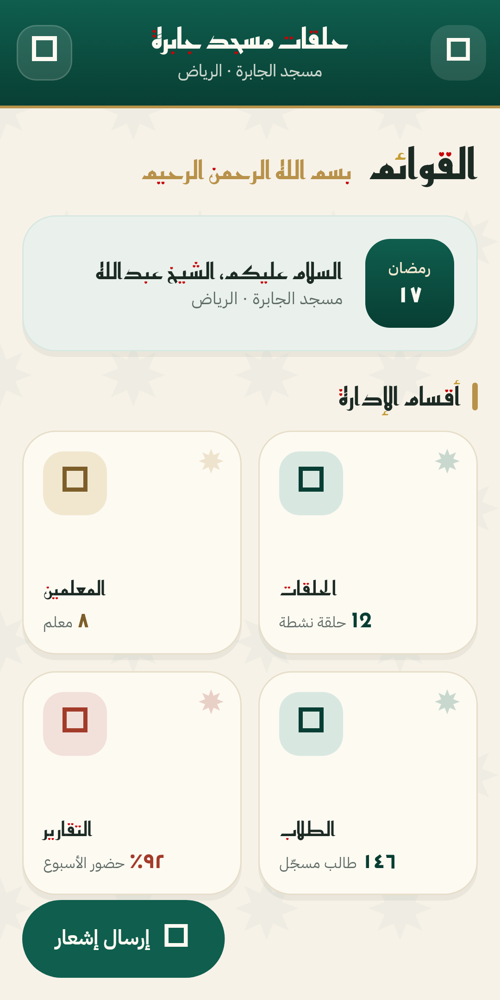
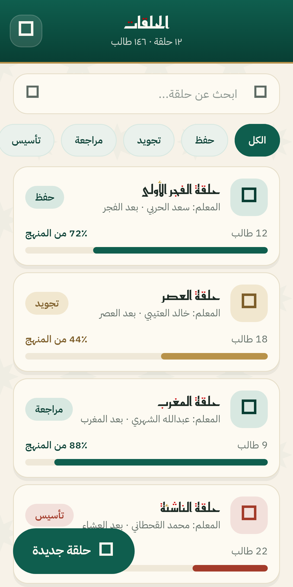
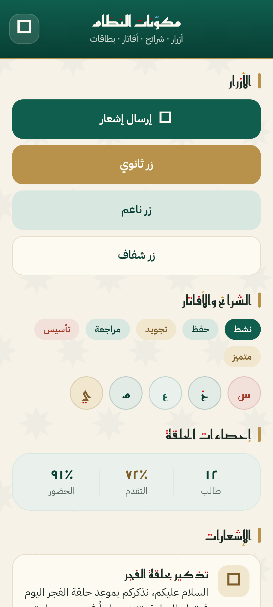

# نظام تصميم حلقات جابرة

> Halaqat Jabra Mosque · Design System v1.0
>
> نظام بصري دافئ يستلهم العمارة الإسلامية التقليدية مع لغة واجهة حديثة:
> أخضر زمردي عميق، ذهب عتيق، وسطح قماشي كريمي. خط عربي عريض للعناوين
> ومحايد للنصوص.

كل ما في هذا الملف مطبَّق في الشيفرة تحت `lib/theme/` و `lib/widgets/ds/`.
القاعدة الوحيدة: **لا تُكتب قيمة لون أو مسافة أو نصف قطر مباشرة في الشاشات** —
كل قيمة تمرّ من الرموز أدناه.

| | |
|---|---|
|  |  |
| الرئيسية · HOME | الحلقات · HALAQAT LIST |



---

## الألوان — `AppColors`

```dart
import 'package:jaberah/theme/theme.dart';
```

### الأساسية

| الرمز | القيمة | الاستعمال |
|---|---|---|
| `AppColors.primary` | `#0F5E4E` | لون الهوية: الشريط العلوي، الأزرار الأساسية، التعبئة |
| `AppColors.primaryDark` | `#083E33` | التدرّجات، النص فوق الأسطح الخضراء الفاتحة |
| `AppColors.primarySoft` | `#D8E8E1` | الأزرار الناعمة، الشرائح، حاويات الأيقونات |
| `AppColors.primaryTint` | `#EAF1EC` | الخلفيات الهادئة، بطاقات الترحيب |
| `AppColors.gold` | `#B8924A` | التمييز الثانوي، الخيط تحت الشريط العلوي |
| `AppColors.goldDark` | `#7D5E2A` | نص ذهبي فوق سطح فاتح |
| `AppColors.goldSoft` | `#F1E7CF` | سطح ذهبي ناعم |
| `AppColors.danger` | `#A33B2A` | الحذف، الخطأ، الغياب |
| `AppColors.dangerSoft` | `#F2E0DB` | سطح أحمر ناعم |

### الأسطح والمحايدات

| الرمز | القيمة | الاستعمال |
|---|---|---|
| `AppColors.bg` | `#F7F2E8` | خلفية الصفحة القماشية |
| `AppColors.bgElev` | `#FDFAF2` | البطاقات والحقول |
| `AppColors.bgSunken` | `#EFE8D8` | مسارات التقدّم والحقول المعطّلة |
| `AppColors.line` | `#E6DEC9` | الحدود والفواصل |
| `AppColors.ink` | `#1C2A24` | النص الأساسي |
| `AppColors.inkMuted` | `#5E6B64` | النص الثانوي |
| `AppColors.inkFaint` | `#8A948E` | التسميات والوحدات |
| `AppColors.onPrimary` | `#FDFAF2` | النص فوق الأسطح الداكنة |

`AppColors.avatarPalette(name)` تُرجع زوج (خلفية، حرف) ثابتاً لكل اسم، فلا
يتغيّر لون الطالب بين الشاشات.

---

## الخطوط — `AppText`

| العائلة | الوزن | الاستعمال |
|---|---|---|
| Reem Kufi Fun | 400 · 500 · 600 · 700 | العناوين والأرقام البارزة (خط ملوّن بنقاط حمراء وذهبية) |
| IBM Plex Sans Arabic | 300 · 400 · 500 · 600 · 700 | النصوص والتسميات والأزرار |
| JetBrains Mono | 400 · 500 · 700 | المعرّفات والأوقات اللاتينية |

الأنماط الجاهزة: `displayLarge` · `displayMedium` · `displaySmall` ·
`displayXSmall` · `appBarTitle` · `appBarSubtitle` · `bodyLarge` · `bodyMedium`
· `bodyStrong` · `caption` · `captionStrong` · `overline` · `button` · `metric`
· `metricSmall` · `mono` · `monoLabel`.

كل نمط يعتمد Reem Kufi Fun أو JetBrains Mono يحمل `fontFamilyFallback` إلى
IBM Plex Sans Arabic: الأول ينقصه `٪` و `﷽`، والثاني لاتيني بحت. بلا الاحتياط
يظهر مربّع فارغ مكان المحرف.

---

## المسافات وأنصاف الأقطار

```dart
AppSpacing.xxs  //  4
AppSpacing.xs   //  8
AppSpacing.sm   // 12
AppSpacing.md   // 16
AppSpacing.lg   // 20
AppSpacing.xl   // 24
AppSpacing.xxl  // 32
AppSpacing.xxxl // 40

AppRadii.sm   // 10      AppRadii.smAll
AppRadii.md   // 14      AppRadii.mdAll
AppRadii.lg   // 18      AppRadii.lgAll
AppRadii.xl   // 24      AppRadii.xlAll
AppRadii.pill // 999     AppRadii.pillAll
```

## الظلال — `AppShadows`

`card` للبطاقات الساكنة · `cardHover` عند اللمس والسحب · `float` للزر العائم.
الظلال مشتقّة من لون الحبر بشفافية منخفضة فتبقى دافئة لا رمادية.

---

## المكوّنات — `lib/widgets/ds/`

```dart
import 'package:jaberah/widgets/ds/ds.dart';
```

| المكوّن | الوصف |
|---|---|
| `JScaffold` | هيكل الشاشة: شريط علوي من النظام وخلفية قماشية مزخرفة بالنجوم |
| `JAppBar` · `JAppBarButton` · `JBrandMark` | شريط زمردي متدرّج، عنوان وسطر توضيحي، شعار المسجد، وخيط ذهبي أسفله |
| `JCard` | البطاقة الأساسية: سطح مرتفع، حدّ رفيع، ظل دافئ، ونجمة زخرفية اختيارية |
| `JIconBadge` | حاوية أيقونة مربّعة بسطح ناعم |
| `JSectionHeader` | شريط ذهبي رفيع + عنوان + إجراء |
| `JStatTile` · `JStatStrip` · `JStat` | بطاقات القائمة الرئيسية وشرائط الإحصاءات |
| `JListCard` · `JDetailRow` · `JCardActions` · `JIconAction` | الشكل المتكرر في قوائم الحلقات والمعلمين والطلاب |
| `JChip` · `JChip.track` · `JFilterChips` | شرائح الحالة (حفظ · تجويد · مراجعة · تأسيس) وصف الترشيح |
| `JAvatar` | أفاتار دائري بأول حرف من الاسم، بلون ثابت مشتق من الاسم |
| `JButton` (+ `.secondary` · `.soft` · `.ghost`) | الأنماط الأربعة مع حالة تحميل مدمجة |
| `JProgressBar` · `JProgressRow` | شريط تقدّم يمتلئ من جهة البداية (يمين الواجهة العربية) |
| `JSearchField` · `JPaginationBar` | حقل البحث وشريط التنقّل بين الصفحات |
| `JLoadingState` · `JEmptyState` | حالات التحميل والقائمة الفارغة |
| `JDialog` + `showJDialog` | الحوار الموحّد: رأس مزخرف، محتوى، وإجراءان |
| `JMotifBackground` · `JStar` · `JOrnamentDivider` | زخرفة النجمة الثمانية — تُرسم بـ`CustomPaint` فتبقى حادة على أي كثافة |

### النغمات — `JTone`

بدل تمرير ثلاثة ألوان لكل مكوّن، تُمرَّر نغمة واحدة فيشتق منها اللون القوي
والسطح الناعم ولون النص:

```dart
JTone.primary   // الحالة الأساسية والإيجابية (حاضر، حفظ، مراجعة)
JTone.gold      // التمييز والتنبيه اللطيف (تجويد، متميز، متأخر)
JTone.danger    // الحذف والخطأ والغياب (تأسيس، غائب)
JTone.neutral   // الحالات الساكنة

tone.solid  tone.soft  tone.tint  tone.onSoft  tone.onSolid
```

مساعدتان تشتقّان النغمة من البيانات:

```dart
toneForTrack('تجويد')  // JTone.gold
toneForRatio(0.9)      // JTone.primary — مرتفعة خضراء، متوسطة ذهبية، منخفضة حمراء
```

---

## مكوّنات مشتركة — `lib/widgets/global/`

`JAppDrawer` · `JTodayCard` · `JHomeHeader` · `JNotificationCard` ·
`confirmExitApp()`.

---

## السمة — `AppTheme.light`

تُركَّب مرة واحدة في `lib/login.dart`، فترث منها كل شاشة — حتى التي لم تُعَد
كتابتها بمكوّنات النظام — الخلفية القماشية والخطوط العربية وأنصاف الأقطار
وألوان الأزرار والحقول والحوارات وشرائط التنبيه، بالإضافة إلى الخيط الذهبي
أسفل كل شريط علوي.

---

## إضافة شاشة جديدة

```dart
import 'package:jaberah/theme/theme.dart';
import 'package:jaberah/widgets/ds/ds.dart';

JScaffold(
  title: 'الحلقات',
  subtitle: '١٢ حلقة · ١٤٦ طالب',
  floatingActionButton: FloatingActionButton.extended(
    onPressed: () {},
    icon: const Icon(Icons.add_rounded),
    label: const Text('حلقة جديدة'),
  ),
  body: Obx(() {
    if (controller.isLoading.value) {
      return const JLoadingState(message: 'جاري التحميل...');
    }
    if (controller.items.isEmpty) {
      return const JEmptyState(title: 'لا توجد بيانات');
    }
    return ListView.separated(
      padding: const EdgeInsets.all(AppSpacing.md),
      itemCount: controller.items.length,
      separatorBuilder: (_, __) => const SizedBox(height: AppSpacing.xs),
      itemBuilder: (context, i) => JListCard(
        leading: JAvatar(name: controller.items[i].name),
        title: controller.items[i].name,
        subtitle: 'المعلم: ...',
        trailing: JChip.track('حفظ'),
        footer: const JProgressRow(value: 0.72, label: '12 طالب'),
      ),
    );
  }),
)
```

---

## التحقّق

`test/design_system_test.dart` يثبّت قيم اللوحة وسلّم المسافات وعائلات الخطوط،
ويتحقّق من سلوك المكوّنات (قصّ قيم التقدّم، تعطيل الزر أثناء التحميل، ثبات لون
الأفاتار، اشتقاق النغمة). شغّله مع بقية الاختبارات:

```bash
flutter test
```

## تراخيص الخطوط

الخطوط الثلاثة تحت رخصة SIL Open Font License 1.1، ونسخة الرخصة مرفقة بجانب كل
عائلة في `fonts/`:

* [Reem Kufi Fun](https://github.com/aliftype/reem-kufi) — Khaled Hosny
* [IBM Plex Sans Arabic](https://github.com/IBM/plex) — IBM Corp.
* [JetBrains Mono](https://github.com/JetBrains/JetBrainsMono) — JetBrains s.r.o.
